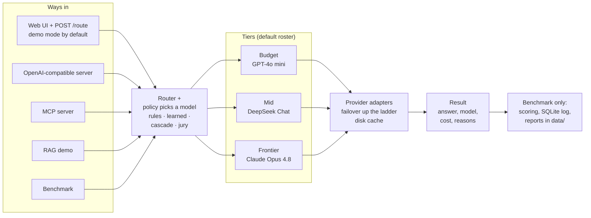

# AI Workload Router


**[Read the case study →](https://phillthereal.github.io/ai-workload-router/case-study.html)** (the benchmark story, with charts) · **[Do you even need a router? →](https://phillthereal.github.io/ai-workload-router/calculator.html)** (an interactive calculator that will tell you when the answer is no) · License: MIT

A portfolio project that sends each LLM task to the cheapest model that can still do it well, and records what that cost and what it did to quality. On a 25-task benchmark with real API calls it cut cost by 53.6% with hand-written task labels and 65.6% with a real classifier, at about the same quality as sending everything to the top model. On a set of hard tasks it saved nothing. It is a personal project and has not served any customer or company traffic.

## The problem

Teams building on LLMs tend to send every request to one expensive frontier model, to be safe. Much of that work is simple: labelling a ticket or pulling a date out of a sentence does not need the most capable model available.

Choosing a cheaper model per task raises three questions:

- **What is it worth?** That depends on how much of the work is easy, and on the price gap between models.
- **How do you know quality held?** You need a score, not a feeling.
- **What does the deciding cost?** A router that pays a model to choose has to charge that against its savings.

This repo tests those questions with measurements, and publishes the cases where routing loses.

## Architecture



- **Policies** decide the model, and all share one interface. *Rules* classify the task and look up a tier. *Learned* checks logged outcomes for similar tasks first. *Cascade* tries the cheap model, has a verifier check the answer, and escalates if it fails. *Jury* escalates when cheap models from different vendors disagree.
- **Adapters** give Anthropic and the OpenAI-style providers one interface, so a model is a config change. If a provider errors, the router tries the next model up and records that in the trace.
- **Rosters** are the sets of models the router can pick from. The default spans three vendors, with about a 42× gap in output price between budget and frontier. `claude_tiers` stays inside one vendor, with a 5× gap.
- **Scoring** only happens in the benchmark, because it needs an answer key. Of the 25 tasks, 10 are graded by exact match and 15 by a Claude Opus 4.8 judge against a rubric.

## Run it in 2 commands

You need Git and Docker. No API keys, and it costs nothing.

```bash
git clone https://github.com/phillthereal/ai-workload-router.git && cd ai-workload-router
```

```bash
docker compose up --build
```

Then open http://localhost:8000, paste a task, and see which model it would go to and why. This is demo mode: **the routing decision is real, but the answer, cost and quality score are simulated**, and the page says so. Real calls need keys and an explicit opt-in, covered in [`docs/DOCKER.md`](docs/DOCKER.md).

The same thing from the command line, while the app is running:

```bash
curl -s -H "Content-Type: application/json" -d '{"prompt":"Classify this review as positive or negative: great phone"}' http://localhost:8000/route
```

### Without Docker

Needs Python 3.11 or newer. All the commands below assume this environment is active.

```bash
python3 -m venv .venv && source .venv/bin/activate
```

```bash
pip install -e ".[web]"
```

```bash
ai-router-web
```

### Ask questions over documents (RAG demo)

A small retrieval demo over three UK government construction and cost documents, which routes its answer through the router. It is command line only, and not in the web UI or Docker image. Retrieval is real and free. Without `--paid` no model is called, so you get the passages and a routing decision but no answer. Details in [`examples/rag/README.md`](examples/rag/README.md).

```bash
pip install -e ".[rag]"
```

```bash
python examples/rag/rag.py ask "How should unknown uncertainties in an estimate be corrected?"
```

```bash
python examples/rag/rag.py eval
```

### Check it offline

These run with no keys and no spend. The benchmark numbers they print are made up by a mock, which is the point: they prove the pipeline works, not that routing does. Remove `AWR_FORCE_MOCK=1` and add keys to `.env` for a live, billed run.

```bash
AWR_FORCE_MOCK=1 python -m unittest discover -s tests
```

```bash
AWR_FORCE_MOCK=1 python run_benchmark.py --classify
```

```bash
AWR_FORCE_MOCK=1 python run_benchmark.py --roster claude_tiers --strategy cascade
```

```bash
python redteam.py heuristic
```

## Measured results

The benchmark rows below came from real API calls, and each links to its committed report. Row-level data for them is in [`data/bi/fact_runs.csv`](data/bi/fact_runs.csv). The confidence intervals are explained in [`docs/ANALYSIS.md`](docs/ANALYSIS.md).

**The two headline runs** use the same 25 tasks and the three-vendor roster, and are compared with sending every task to Claude Opus 4.8.

| | Frontier only | Hand labels ([report](data/benchmark_report.md)) | Real classifier ([report](data/benchmark_report_cross_vendor_classified.md)) |
|---|---|---|---|
| Run | | `20260717T082024-098a7982` | `20260717T164636-ee1ddc99` |
| Total cost, including routing | $0.125980 | $0.058506 | $0.043299 |
| **Cost cut** [95% CI] | | **53.6%** [29.9, 82.6] | **65.6%** [40.3, 97.7] |
| Mean quality | 0.992 | 0.996 | 0.990 |
| **Quality vs frontier only** [95% CI] | | **100.4%** [99.0, 102.0] | **99.8%** [97.8, 101.6] |
| Mean latency | 4,155 ms | 2,237 ms | 1,989 ms |

How to read them:

- **They are two different claims.** Hand labels are a clean test of the idea, but a real system only gets a prompt. The classifier is what a real system would use, and its result includes the $0.000822 it cost to run. It agreed with my hand labels on 68% of tasks.
- **Saving more was not free.** Quality on short writing tasks fell from 0.975 to 0.958 in the classifier run, which the overall mean hides.
- **The sample is small.** This is 25 short tasks and about 13 cents of spend at frontier prices, so the intervals are wide. Treat the percentages as directional.
- **Reasoning tasks do not get cheaper.** They go to the frontier model either way. They are 16% of the tasks and 33% of the baseline bill, which limits what routing can save here.
- **The target was set first:** at least 40% cheaper while keeping at least 95% of quality. Both runs passed.

**Other runs.** The easy set scores about 0.99 on every tier, so it cannot show whether routing protects quality. The 10-task hard set can: on it, Haiku scored 0.70, Sonnet 0.90 and Opus 1.00. The classifier was never run on the hard set with the three-vendor roster, so the hard rows do not compare directly with the headline runs.

| Models | Method | Task set | Cost cut | Quality vs frontier only | Report |
|---|---|---|---|---|---|
| Claude tiers | Classifier | Easy, 25 | 42.5% [23.4, 66.8] | 100.3% | [report](data/benchmark_report_claude_tiers_classified.md) |
| Claude tiers | Cascade | Easy, 25 | 53.1% [25.1, 72.1] | 99.6% | [report](data/benchmark_report_claude_tiers_cascade.md) |
| Claude tiers | Classifier | Hard, 10 | **−6.3%** [−21.6, 6.7] | 100% | [report](data/benchmark_report_claude_tiers_classified_hard.md) |
| Claude tiers | Cascade | Hard, 10 | **−19.9%** [−63.4, 7.1] | 100% | [report](data/benchmark_report_claude_tiers_cascade_hard.md) |
| Claude tiers | Cascade, Haiku as verifier | Easy, 25 | 85.0% | 99.6% | [report](data/benchmark_report_claude_tiers_cascade_verifier-claude-haiku-4-5.md) |
| Claude tiers | Cascade, Haiku as verifier | Hard, 10 | 73.8% | **70.0%** | [report](data/benchmark_report_claude_tiers_cascade_verifier-claude-haiku-4-5_hard.md) |
| Three cheap models, then Opus | Jury, unanimous | Easy, 25 | 66.1% | 99.8% | [report](data/benchmark_report_claude_tiers_jury_unanimous.md) |
| Three cheap models, then Opus | Jury, unanimous | Hard, 10 | 22.4% | **86.0%** | [report](data/benchmark_report_claude_tiers_jury_unanimous_hard.md) |

The lesson across these runs: **savings depend on how much of the work is genuinely easy, and on the price gap between models.** On all-hard work, routing costs more than it saves. The cheap shortcuts that looked best on the easy set, a Haiku verifier and a jury of cheap models, lost quality on the hard set: Haiku scored its own wrong answers highly, and all three jury vendors agreed on the same wrong answer in one task.

**Experiments on specific risks.** These vary in method, and each row says so where it matters.

| Question | Finding | Write-up |
|---|---|---|
| Can a router learn from its own history? | On a 14-task held-out set it saved 26.1%, against 4.4% for the static router, at equal quality. Only works if task shapes repeat. | [V3_FINDINGS](docs/V3_FINDINGS.md) |
| Can words in a prompt steer the routing? | Attacks that inflate cost fell from 7/10 to 0/10 on the keyword classifier after hardening, and 3/10 to 0/10 on the LLM classifier. Making a hard task look easy still works 2/9 times. | [V5_REDTEAM](docs/V5_REDTEAM.md) |
| Does the result survive price changes? | Re-priced at OpenRouter's list prices, the 53.6% run came out at 53.58%. | [V5_PRICES](docs/V5_PRICES.md) |
| Can a spend cap and a background check run unattended? | In simulation only: checking 5% of traffic caught a quality drop in 83.3% of runs, for 6.1% extra cost. | [V5_BUDGET_SHADOW](docs/V5_BUDGET_SHADOW.md) |
| Is Kimi K3 a cheaper mid tier? | No. It has Sonnet's list price plus billed reasoning. An offline projection from real token counts, with no live quality run. | [V5_KIMI_OFFLINE](docs/V5_KIMI_OFFLINE.md) |
| Does it work on real text? | On 150 of my own emails, from a personal setup, the keyword classifier sent everything to the top tier. A cheap-first cascade saved 76.4% at 95.3% agreement with Haiku, but missed 1 of 13 emails that needed action. | [REAL_TRAFFIC_ASSESSMENT](docs/REAL_TRAFFIC_ASSESSMENT.md), [SHADOW_TEST](docs/SHADOW_TEST.md) |
| Is the judge reliable? | A second judge from another vendor, GPT-4o mini, re-scored the 30 rubric-judged answers from the hand-label run: 96.7% within 0.15, mean difference 0.010. No human has scored them yet. | [CASE_STUDY](CASE_STUDY.md#validating-the-judge) |

**RAG retrieval**, on 13 questions I wrote myself. `rag.py eval` prints the hybrid row:

| Retrieval | Right page first | Right page in top 4 |
|---|---|---|
| Embeddings only | 6/13 | 11/13 |
| Keywords only | 9/13 | 12/13 |
| **Hybrid (used)** | **10/13** | **12/13** |

### Simulated output (not results)

None of the following is evidence of anything. It exists so the project runs for free.

- **Web UI and Docker demo mode:** answers, tokens, costs and quality scores are simulated, and the response says `simulated: true` and `quality_source: simulated`. Routing here uses the free keyword classifier, not the LLM classifier measured above.
- **`AWR_FORCE_MOCK=1` benchmark runs:** the numbers come from a fixed table and go to gitignored `data/benchmark_report_simulated_*.md` files. They can never overwrite a published report.
- **RAG demo without `--paid`:** the retrieved passages are real, the cost is simulated, and there is no answer.

## Limitations

**The newest parts are untested with real models.**

- The web app and RAG demo have only been run in free demo mode. **No real paid call has gone through either of them.** Paid mode is covered by stubbed tests only.
- Quality scores in the web app are simulated in demo mode. In paid mode they would be a model's estimate with no answer key, and the mid model grades itself when it wrote the answer. They are not the benchmark's score.
- RAG retrieval is 10/13 first place and 12/13 in the top 4, on a small set I wrote after reading the pages, so its wording matches the documents.
- **RAG answer quality has not been measured.**

**Known bug, documented and not fixed.** In real mode, the classifier silently falls back to the free keyword heuristic if it has no key or its call fails, and `Result.simulated` stays `False`. Only a detail in the trace shows it happened, and that heuristic sent 100% of the email above to the top tier. This and 13 other design problems are listed in [PR #2](https://github.com/phillthereal/ai-workload-router/pull/2). Two more affect cost: failed calls are not costed, and the HTTP server's daily budget can overshoot under concurrent requests.

**The benchmark is small.**

- 25 tasks is a starting eval, not proof for any real workload. The hard set is 10 tasks, and the intervals on its two cost results include zero.
- Tasks are single-turn. Conversations and tool use are not covered.
- The judge is an LLM. Two judges agreeing does not rule out a shared blind spot, and [`data/human_label_sheet.csv`](data/human_label_sheet.csv) has not been scored against them. A hostile task could also try to inject instructions into the judge.
- The results cannot be replayed from a fresh clone. `.cache/` and `data/runs.db` are not committed, so a live re-run needs your own keys and your own spend. A few scripts, such as `analyze.py` and `simulate_v5.py`, need `data/runs.db` and will not run without it.

**It is not ready to serve real users.**

- The web app has no login, so it only accepts localhost.
- Spend limits are held in memory and reset on restart.
- Docker uses an editable install, as a workaround for paths that depend on the source tree.
- `.cache/` and `--log-db` store prompts and responses in plain text. Both are gitignored, but treat them as sensitive.

## What I'd do next

1. **Run one small, capped real call** through the web app and the RAG `--paid` path, so the paid paths have been proven once. It would cost cents, and it was deliberately left out of this round.
2. **Fix the silent classifier fallback** so a downgrade shows up in the result.
3. **Measure RAG answer quality** with answers written in advance, and add a "not found" threshold.
4. **Count the cost of failed calls** and reserve the worst case before each call, so reported spend matches what a provider bills.
5. **Grow the eval:** more tasks from one real workload, human scores against the judges, and the hard set on the three-vendor roster.
6. **Fix the source-relative paths,** so a normal install works and Docker can drop the workaround.
7. **For real users:** add authentication, per-client limits, and a shared store for spend, so limits survive restarts and work across instances.

## Other ways to use it

**Python.** With keys in `.env`, or `AWR_FORCE_MOCK=1` set for a free simulated answer:

```python
from router.api import Router, CascadePolicy
r = Router(CascadePolicy(), roster_name="claude_tiers").complete("Summarize: ...")
print(r.model, r.total_cost_usd, r.trace)
```

**OpenAI-compatible endpoint** (standard library only). Point any OpenAI SDK at `http://127.0.0.1:8787/v1` and choose a policy with the `model` field: `router`, `router:cascade`, `router:learned` or `router:frontier`. Each response has an `x_router` block showing the decision and its cost. Without the mock flag this makes real calls.

```bash
AWR_FORCE_MOCK=1 python serve.py --port 8787
```

- **Auth:** bearer auth is on by default. `serve.py` prints a generated token once to stderr, or set `AWR_SERVER_TOKEN`.
- **Request checks:** localhost only by default. Requests must be `application/json`, the `Host` header must be loopback or the explicit `--host`, and anything with an `Origin` header is refused.
- **Spend guards:** `--daily-budget` (default $1.00 per UTC day), `router:frontier` off unless `--allow-frontier`, 30 requests a minute, a 256 KB body cap, a 30 s socket timeout and 8 concurrent requests.
- **Logging:** `--log-db live.db` also logs requests, including prompt text, and turns on `POST /v1/feedback`, which feeds ratings to the learned policy.

**MCP server.** `ai-router-mcp` gives any MCP client (Claude Code, Cursor, Claude Desktop) five tools to classify a task, estimate cost and explain a decision. It is free and offline by default. See [`docs/MCP_SERVER.md`](docs/MCP_SERVER.md) and a real session in [`docs/MCP_DEMO.md`](docs/MCP_DEMO.md).

## Project docs

- [`CASE_STUDY.md`](CASE_STUDY.md): why it was built, how scope was cut, method and full results.
- [`docs/DECISION_LOG.md`](docs/DECISION_LOG.md): the product calls, what each was traded against, and the evidence.
- [`docs/PRD.md`](docs/PRD.md): requirements, success metrics and the core hypothesis.
- [`docs/ANALYSIS.md`](docs/ANALYSIS.md): confidence intervals and SQL answers to product questions. Power BI tables are in `data/bi/`, with a guide in [`docs/POWER_BI_GUIDE.md`](docs/POWER_BI_GUIDE.md).
- [`docs/V2_FINDINGS.md`](docs/V2_FINDINGS.md): the full strategy matrix, the effort grid and verifier economics.
- [`docs/V3_DESIGN.md`](docs/V3_DESIGN.md) and [`docs/V3_FINDINGS.md`](docs/V3_FINDINGS.md): the learned router.
- [`docs/V5_JURY.md`](docs/V5_JURY.md): the cheap-model jury and why it is not safe on hard work.
- [`docs/JEV_CALIBRATION.md`](docs/JEV_CALIBRATION.md) and [`docs/JEV_LOOP.md`](docs/JEV_LOOP.md): a self-improving email classifier. Rulebook rounds raised the share of held-out emails it handled alone from 36% to 60%, and showed where more rounds started to overfit.
- [`docs/IMPROVEMENT_ROUND_2026-10.md`](docs/IMPROVEMENT_ROUND_2026-10.md): six ideas tested against a bar set in advance, most of which failed.
- [`docs/DOCKER.md`](docs/DOCKER.md): every environment variable and the Docker limits.
